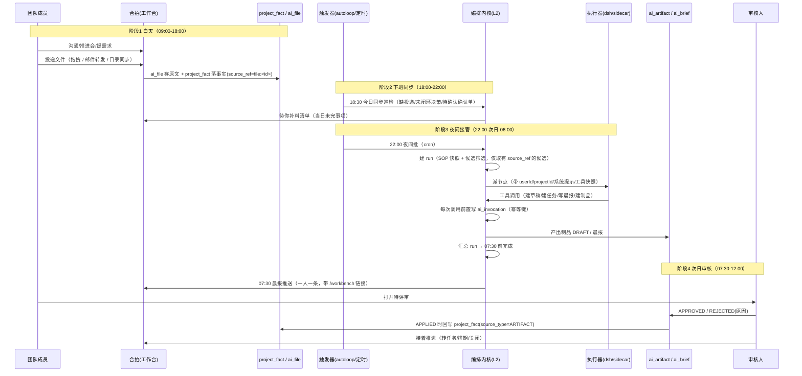

# 合拍 AI 业务流程设计（一天的闭环）

> 一天四个阶段：**白天协作 → 下班同步 → 夜间接管 → 次日审核**。
> 本文定时序、触发、状态机、异常路径与 SLA。架构见 [01-architecture.md](01-architecture.md)，表结构见 [03-functions.md](03-functions.md)。

## 一、总时序



## 二、触发矩阵

| 时间 | 触发 | 载体 | 幂等口径 | 失败后果 |
|---|---|---|---|---|
| 每 30 分钟 | 事实汇入（会议/邮件/工作项/大事儿） | `ProjectFactIngestScheduler`（已有） | `dedupe_hash = sha256(source_type\|source_ref)` 唯一 | 单项目失败只跳过该项目 |
| 18:30（工作日） | 今日同步巡检：缺投递项目、有决议无任务、待确认超 48h | autoloop 规则 → `POST /internal/project-context/run` | `(rule, biz_date)` 只跑一次 | 不阻断夜间批，缺陷记入运行面 |
| 22:00（工作日） | 夜间批（主链路） | autoloop cron → `night-batch-trigger.sh` → `POST /internal/project-context/night-batch`（**规则里不写流程**） | `(kind, sop_code, project_id, owner_user_id, biz_date)` 唯一；重复调用返回同一 run | 单节点失败不影响兄弟节点；run 标记 `PARTIAL` |
| 23:00（工作日） | M2 代码类夜间任务（队列驱动） | autoloop cron + `tools/m2/queue` | `(project_id, queue_item, biz_date)` | 队列为空跳过（已有行为） |
| 07:30（工作日） | 晨报分发 | 合拍 `AiProactivePushScheduler` / autoloop 晨报补发 | `ai_brief(user_id, brief_date, project_id)` 唯一 | 推送失败重试 3 次，失败进运行面 |
| 事件驱动 | 会议纪要确认、周报生成失败、报价 SENT 超期、大事儿逾期 | 合拍业务钩子 `POST` autoloop `emit`，或直接建单步 run | 事件 `id` 去重 | 丢弃并记 `ai_run` 失败原因 |

原则：**定时只决定「什么时候」，规则不写「怎么干」**。多步流程一律由合拍编排的 SOP 定义（`ai_run` 快照）。

## 三、状态机

### 3.1 `ai_run`（一次夜间批 / 一次流程实例）

```
PENDING ──admit──> RUNNING ──┬──> SUCCEEDED        （全部节点成功 或 只剩 gate 等待且已通知）
                             ├──> PARTIAL          （有节点失败，但产出可评审，run 可收尾）
                             ├──> FAILED           （关键节点失败，无可用产出）
                             ├──> WAITING_HUMAN    （停在 gate）
                             └──> CANCELLED        （人取消 / 预算耗尽）
```

- 只有 `SUCCEEDED / PARTIAL / FAILED / CANCELLED` 是终态；`WAITING_HUMAN` 可回到 `RUNNING`（gate 放行）或 `CANCELLED`（gate 驳回且不重跑）。
- 迁入终态必须写 `finished_at` 与 `summary`（供晨报/运行面消费）。

### 3.2 `ai_run_node`（SOP 节点）

```
PENDING ──deps_ready──> READY ──lease──> RUNNING ──┬──> SUCCEEDED
                                                   ├──> FAILED（attempt 用尽）
                                                   ├──> WAITING_GATE
                                                   └──> UNKNOWN（执行器失联/结果未知）
RETRY：FAILED/UNKNOWN ──> READY（attempt+1，超 max_attempt 则 FAILED）
REWORK：gate 驳回 ──rejectTo──> 目标节点 READY，目标及其后代 attempt 归零、上游 SUCCEEDED 保留
```

- 启动条件：**所有入边前驱 SUCCEEDED**（同一节点内并行不受影响）。
- 租约：`lease_owner + lease_expires_at + epoch`；心跳续租，过期可被接管，接管时 `epoch+1`，旧 epoch 的写入被拒。

### 3.3 `ai_gate`（人工闸门）

```
PENDING ──approve──> APPROVED    （节点 SUCCEEDED，写 decision 制品）
        ──reject───> REJECTED    （按 reject_to 走 REWORK，或直接 FAILED）
        ──retry────> APPROVED_RETRY（不推进，重跑本节点）
        ──timeout──> EXPIRED     （SLA 到期；不自动批准，只上报）
```

- 决策落 `decision.json` 制品（`ai_artifact.kind=DECISION`），与 approve 同事务或 outbox。
- 提交时携带 `node_status + attempt + rework_count` 期望值，不匹配返回 409（防重复/过期提交）。

### 3.4 `ai_artifact`

沿用现有五态：`DRAFT → IN_REVIEW → APPROVED / REJECTED → APPLIED`。
新增：`attempt`、`evidence`（factId 列表，必填）、`content_hash`、`upstream_artifact_ids`（下游可引用上游冻结结果）。当前 M1 已实现五态与评审队列，本目标只加字段与 gate 联动。

### 3.5 `ai_brief`

`(user_id, brief_date, project_id)` 唯一，重复写覆盖（现状）。新增：`source_run_id`，用于「这份晨报由哪次 run 产出」回溯；不允许非夜间链路（如试跑）覆盖已分发晨报 —— 服务层加 `overwrite=false` 保护。

## 四、异常与补偿

| 现象 | 判定依据 | 处理 |
|---|---|---|
| 工具已提交、结果未落 | `ai_invocation` 有 `call_id` 无 `result` | 节点置 `UNKNOWN`；下一轮先查外部状态（业务表 / 源系统），确认已生效则补写结果，未生效才重试 |
| 执行器进程死亡 | 心跳超时（默认 90s） | 租约过期后接管，`epoch+1`；未完成调用按上一条处理 |
| 模型输出不合契约 | 回执解析失败 / 缺证据 | 节点 `FAILED`，不进入评审；错误摘要进运行面，不进晨报正文 |
| 同一候选被两个规则同时抓 | `(sop_code, project_id, biz_date)` 与候选 `dedupe_key` | 第二个 run 直接复用第一个的 run_id，不重复派活 |
| 审批重复提交 | 期望值不匹配（409） | 第二次返回 409，不产生副作用 |
| 打回后上游证据丢失 | 上游节点被重跑 | 上游产物按 `attempt` 冻结保存，`upstream_artifact_ids` 指向冻结版本 |
| 夜间跑完但晨报推送失败 | `ai_brief.delivered_at` 为空 | 07:30 起每小时重试，3 次后进运行面「未送达」列表 |
| 文件重复投递 | `sha256` 相同 | `ai_file` 复用，仅新增 `project_fact` 关联（或按 dedupe_hash 合并） |

## 五、SLA / 预算

| 项 | 值 | 说明 |
|---|---|---|
| 夜间批开始 | 22:00 ±2 分钟 | 触发器延迟容忍 |
| 夜间批完成 | 次日 06:00 前 | 未完成则 `PARTIAL` 并进运行面 |
| 晨报分发 | 07:30 ±5 分钟 | 失败重试至 09:00 |
| 单节点执行上限 | 15 分钟（可配） | 超时 → `UNKNOWN` 或 `FAILED`（按是否已产生外部写区分） |
| 单 run 工具调用上限 | 40 次 | 超出 `CANCELLED`，原因写入 |
| 单 run token 预算 | 由配置项控制，超限终止并报告 | 现状：`ai_agent_usage` 已有计量基础 |
| 审批期望时长 | 次日 12:00 前 | 超时 `EXPIRED`（不自动放行） |

## 六、与现状的差异（要改什么）

| 现状 | 问题 | 本设计 |
|---|---|---|
| autoloop 规则 prompt 直接承载流程 | 流程写在 prompt 里，无法审计、无法返工 | 规则只发「开始夜间批」；流程由 SOP 快照定义 |
| `AutomationRunService` 系统提示硬编码「写晨报」 | 所有规则被迫写晨报，互相覆盖（实测 2026-11-22 晨报被试跑覆盖） | 系统提示与产出口径由规则/节点传入；`ai_brief` 加覆盖保护 |
| 单步执行，无 run/node | 失败只能整轮重跑，无法定位 | run/node/attempt 三层 + 租约 |
| 无 call 前置记录 | 「已写但不知道」无法识别 | `ai_invocation` 前置写 + `UNKNOWN` 语义 |
| 制品无 attempt/证据哈希 | 打回重跑后无法比对 | 制品按 attempt 冻结 + `content_hash` |
